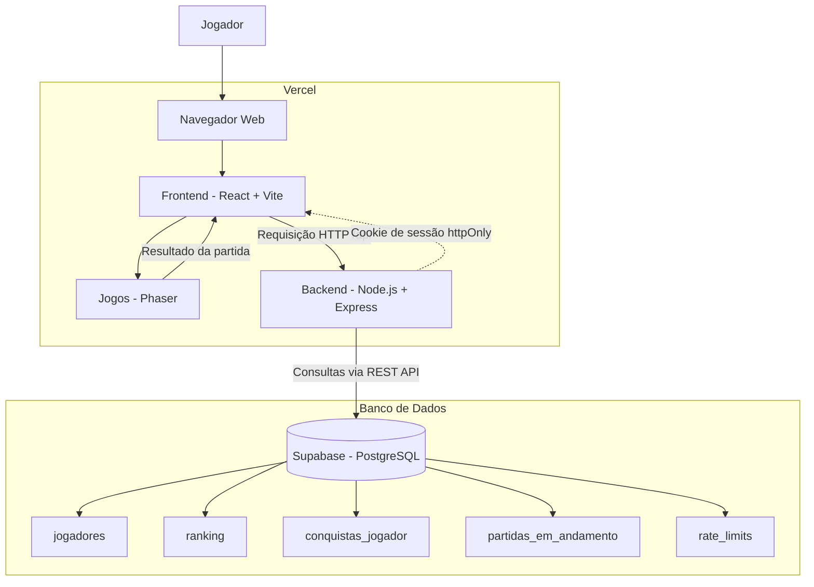

# JBIFC — Portal de Minijogos

A **JBIFC** é uma empresa fictícia de desenvolvimento de jogos, criada no contexto de um projeto acadêmico. Seu primeiro lançamento é **A Regular Mosquito's Day**, um jogo web de entretenimento no estilo arcade, inspirado em títulos como *WarioWare* e *Dumb Ways to Die*, com estética pixel art e desafios variados.

O jogo reúne diferentes minijogos que testam os reflexos, a atenção e a capacidade de reação dos jogadores. A plataforma conta com sistema de contas, pontuação, ranking online e conquistas.

> **Aviso:** Este é um projeto acadêmico independente, sem vínculo institucional com o Instituto Federal Catarinense (IFC).

---

## Sumário

- [Sobre o projeto](#sobre-o-projeto)
- [Objetivo e público-alvo](#objetivo-e-público-alvo)
- [Funcionalidades](#funcionalidades)
- [Responsividade](#responsividade)
- [Minijogos](#minijogos)
- [Tecnologias utilizadas](#tecnologias-utilizadas)
- [Arquitetura](#arquitetura)
- [Estrutura do projeto](#estrutura-do-projeto)
- [Banco de dados](#banco-de-dados)
- [Características e segurança](#características-e-segurança)
- [Executando localmente](#executando-localmente)
- [Variáveis de ambiente](#variáveis-de-ambiente)
- [API](#api)
- [Publicação](#publicação)
- [Equipe](#equipe)
- [Licenças e créditos](#licenças-e-créditos)

---

## Sobre o projeto

*A Regular Mosquito's Day* é um jogo web de entretenimento com temática arcade, composto por um portal que reúne uma coleção de minijogos independentes.

Cada partida é formada por uma sequência de desafios curtos. O jogador começa com três vidas e precisa cumprir as instruções apresentadas em cada rodada. Cada vitória concede pontos, enquanto cada derrota consome uma vida.

Ao perder todas as vidas, a partida termina. Jogadores autenticados podem salvar suas pontuações no banco de dados e acompanhar seu desempenho no ranking.

O projeto foi desenvolvido com foco em:

- Desenvolvimento de aplicações web modernas.
- Integração entre frontend, backend e banco de dados.
- Autenticação e segurança de usuários.
- Desenvolvimento de jogos 2D executados no navegador.
- Organização modular e manutenção de código.

## Objetivo e público-alvo

O objetivo do projeto é oferecer uma plataforma de entretenimento acessível pelo navegador, reunindo minijogos independentes em uma única aplicação, com desafios rápidos e diferentes mecânicas de interação.

O projeto também busca aplicar conhecimentos de desenvolvimento web, integração de sistemas, persistência de dados, autenticação e desenvolvimento de jogos.

**Problema abordado:** muitos jogos de navegador oferecem experiências isoladas, sem necessariamente reunir diferentes desafios, acompanhamento de desempenho e competição entre jogadores em uma única plataforma. A proposta é centralizar essas experiências em um portal com funcionalidades integradas.

**Público-alvo:** pessoas interessadas em jogos casuais, desafios rápidos e experiências no estilo arcade, especialmente usuários que acessam jogos por computadores e navegadores web.

---

## Funcionalidades

### Portal

- Página inicial com apresentação do projeto.
- Navegação entre as páginas.
- Página de tutorial e instruções.
- Página de apresentação da equipe.
- Interface com identidade visual própria.
- Layout responsivo para diferentes tamanhos de tela.

### Contas e autenticação

- Cadastro com nome de usuário e senha.
- Regras de validação para nome de usuário e senha.
- Login com autenticação JWT, entregue em cookie httpOnly.
- Encerramento de sessão (logout).
- Senhas armazenadas por meio de hash bcrypt.
- Verificação da autenticação do usuário em rotas protegidas.
- Possibilidade de jogar sem conta no modo de demonstração (a pontuação não é salva).

### Sistema de jogo

- Partidas com três vidas.
- Seleção de minijogos.
- Instruções antes de cada rodada.
- Sistema de pontuação.
- Sequência de vitórias.
- Dificuldade progressiva.
- Tela de fim de partida.
- Opção de tentar novamente o salvamento de uma pontuação.
- Registro de cada partida no servidor, usado para validar a pontuação enviada.

### Ranking e conquistas

- Ranking online integrado ao Supabase.
- Registro da melhor pontuação de cada jogador.
- Classificação por pontuação e critérios de desempate.
- Destaque para os três primeiros colocados.
- Sistema de conquistas.
- Registro do total de partidas dos jogadores.

---

## Responsividade

O portal **A Regular Mosquito's Day** possui uma interface responsiva, adaptada para diferentes tamanhos de tela, incluindo computadores, tablets e smartphones.

A responsividade contempla as páginas institucionais, os menus, os elementos de navegação e os demais componentes da interface web.

**Limitação:** embora o portal possa ser acessado em dispositivos móveis, os minijogos foram desenvolvidos e otimizados para computadores. Portanto, a experiência de jogo em smartphones e tablets não é garantida, podendo apresentar limitações de jogabilidade, controles ou visualização.

| Componente | Responsividade |
|---|---|
| Portal e páginas institucionais | Responsivo |
| Menus e navegação | Responsivos |
| Interface geral | Adaptável a diferentes telas |
| Minijogos Phaser | Otimizados para computadores |
| Jogabilidade em dispositivos móveis | Não garantida |

---

## Minijogos

O projeto possui atualmente os seguintes minijogos:

| Minijogo | Arquivo |
|---|---|
| Lockpick | `lockpick.js` |
| Não Seja Pego | `naoSejaPego.js` |
| Vigília dos Porcos | `vigiliaDosPorcos.js` |

Cada minijogo possui sua própria implementação, permitindo adicionar novos desafios sem precisar reescrever o funcionamento principal das partidas.

---

## Tecnologias utilizadas

### Frontend

| Tecnologia | Utilização |
|---|---|
| JavaScript | Linguagem de programação principal |
| React 19 | Construção da interface |
| Vite | Ambiente de desenvolvimento e build |
| Tailwind CSS 4 | Estilização |
| React Router | Navegação entre páginas |
| Phaser 4 | Desenvolvimento dos minijogos |
| Axios | Comunicação com a API |
| Lucide React | Ícones |

### Backend

| Tecnologia | Utilização |
|---|---|
| JavaScript (Node.js) | Linguagem e ambiente de execução |
| Express 5 | Construção da API |
| Supabase | Acesso ao banco PostgreSQL por API REST |
| bcryptjs | Geração e verificação de hashes de senhas |
| JSON Web Token | Autenticação de usuários |
| express-rate-limit | Limitação de requisições |
| Store de rate limit própria | Contagem de requisições compartilhada entre instâncias, guardada no Supabase |
| CORS | Controle de acesso entre origens |
| dotenv | Gerenciamento de variáveis de ambiente |

### Infraestrutura e ferramentas

- **Vercel Services:** hospedagem do frontend e backend.
- **Supabase:** gerenciamento do banco de dados PostgreSQL.
- **Git e GitHub:** versionamento e gerenciamento do código.
- **Visual Studio Code:** ambiente de desenvolvimento.

---

## Arquitetura

O projeto utiliza uma arquitetura cliente-servidor, dividida em frontend, backend e banco de dados.

### Diagrama de arquitetura



### Funcionamento da arquitetura

O **frontend** é responsável pela interface, navegação e execução dos jogos. O Phaser executa os minijogos e comunica os resultados das partidas ao React, que realiza o envio das pontuações ao backend por meio de requisições HTTP.

O **backend** processa as requisições, valida os dados recebidos, autentica os usuários e realiza as operações necessárias no banco de dados.

O **banco de dados** mantém as informações dos jogadores, pontuações e conquistas, utilizando PostgreSQL por meio do Supabase.

### Organização dos serviços na Vercel

O projeto utiliza dois serviços dentro da mesma estrutura de implantação:

- `frontend`: aplicação React construída com Vite.
- `backend`: API desenvolvida com Express.

As requisições iniciadas com `/api/` são direcionadas ao backend. As demais são encaminhadas ao frontend.

---

## Estrutura do projeto

```text
JBIFC/
├── backend/
│   ├── conquistas.js
│   ├── rateLimitStore.js
│   ├── server.js
│   ├── supabase-schema.sql
│   └── package.json
│
├── docs/
│   ├── Requisitos.md
│   └── structure.txt
│
├── frontend/
│   ├── public/
│   │   ├── fonts/
│   │   ├── game/
│   │   └── music/
│   │
│   ├── src/
│   │   ├── assets/
│   │   ├── auth/
│   │   ├── components/
│   │   ├── game/
│   │   │   ├── cenas/
│   │   │   └── minigames/
│   │   ├── pages/
│   │   └── styles/
│   │
│   ├── index.html
│   ├── vite.config.js
│   └── package.json
│
├── .gitignore
├── vercel.json
└── README.md
```

### Organização do frontend

- `auth/`: contexto de autenticação (`AuthProvider`, `useAuth`), que consulta o servidor para saber quem está logado.
- `components/`: componentes reutilizáveis da interface.
- `game/cenas/`: cenas responsáveis pelo fluxo do jogo.
- `game/minigames/`: implementações individuais dos minijogos.
- `pages/`: páginas principais do portal.
- `styles/`: estilos globais, fontes e identidade visual.

### Organização do backend

- `server.js`: configuração do servidor, rotas, autenticação e operações com o banco.
- `conquistas.js`: regras e processamento das conquistas e validação do resumo da partida.
- `rateLimitStore.js`: armazenamento dos contadores de limite de requisições no Supabase.
- `supabase-schema.sql`: estrutura SQL do banco de dados.

---

## Banco de dados

O projeto utiliza PostgreSQL por meio do Supabase.

O banco possui cinco tabelas:

| Tabela | Responsabilidade |
|---|---|
| `jogadores` | Armazena contas, hashes de senha e total de partidas. |
| `ranking` | Armazena a melhor pontuação registrada de cada jogador. |
| `conquistas_jogador` | Armazena as conquistas desbloqueadas pelos jogadores. |
| `partidas_em_andamento` | Guarda a partida em andamento de cada jogador, com o horário de início registrado pelo servidor. |
| `rate_limits` | Guarda os contadores do limite de requisições (a chave é um hash, não o IP). |

Também existe a view `ranking_posicoes`, responsável por calcular a posição dos jogadores com base na pontuação e nos critérios de desempate.

O banco ainda possui funções SQL usadas pelo backend: `incrementar_partidas` (soma atômica do total de partidas) e `rate_limit_hit`, `rate_limit_undo` e `rate_limit_reset` (contadores do limite de requisições). Todas podem ser executadas apenas pelo papel `service_role`.

### Relacionamentos

- Um jogador pode possuir um registro no ranking.
- Um jogador pode desbloquear várias conquistas.
- Um jogador possui, no máximo, uma partida em andamento por vez.
- A exclusão de um jogador remove seus registros relacionados por meio de exclusão em cascata.

A estrutura completa do banco pode ser encontrada em:

`backend/supabase-schema.sql`

---

## Características e segurança

### Usabilidade e responsividade

O portal possui layout responsivo, adaptando sua interface a diferentes resoluções de tela, incluindo computadores, tablets e celulares.

Entretanto, existe uma distinção importante: **a interface do portal é responsiva, mas os minijogos foram desenvolvidos para utilização em computadores**. Portanto, a experiência de jogo em dispositivos móveis não é suportada, especialmente devido às limitações de interação por toque e à adaptação dos controles.

A navegação entre as páginas e a organização dos conteúdos buscam facilitar o acesso às funcionalidades disponíveis.

### Desempenho

- O Vite é utilizado para o desenvolvimento e a geração da versão de produção do frontend.
- Os minijogos são carregados e executados no navegador por meio do Phaser.
- A comunicação entre frontend e backend utiliza requisições HTTP.
- O banco de dados centraliza as informações persistentes dos jogadores.
- O código dos minijogos é organizado em módulos independentes, facilitando sua manutenção e expansão.

### Acessibilidade

A interface utiliza textos, elementos visuais e componentes de navegação para orientar o usuário durante a utilização do portal.

Os minijogos, entretanto, possuem interações específicas e não foram projetados para garantir compatibilidade completa com tecnologias assistivas. O projeto não declara conformidade com padrões como WCAG.

### Segurança

A aplicação combina medidas no servidor, no banco de dados e no navegador. A tabela resume o que cada uma protege, e os detalhes vêm logo depois.

| Risco | Medida adotada |
|---|---|
| Vazamento de senhas | Hash bcrypt (custo 12); a senha nunca é guardada nem registrada em texto puro. |
| Roubo de sessão por XSS | Cookie httpOnly, Content Security Policy e nenhum uso de HTML dinâmico no React. |
| Requisições forjadas por outros sites (CSRF) | Cookie SameSite=Lax e verificação de origem nas requisições que alteram dados. |
| Força bruta e abuso | Limites por IP, por conta e por usuário, com contagem compartilhada no banco. |
| Pontuação forjada | Partida registrada no servidor, de uso único, com tempo mínimo e validação cruzada do resumo. |
| Acesso direto ao banco | Row Level Security, permissões públicas revogadas e chave de serviço só no backend. |
| Injeção de dados | Validação rigorosa de entrada e identificadores tipados antes de montar consultas. |
| Clickjacking e conteúdo malicioso | CSP, `X-Frame-Options` e `nosniff`. |
| Dependências vulneráveis | `npm audit` sem vulnerabilidades conhecidas nas dependências de produção; dependências sem uso removidas. |

**1. Senhas**

O backend usa `bcryptjs` com custo 12. No login, quando o usuário não existe, o servidor compara a senha com um hash falso para que o tempo de resposta seja parecido, o que dificulta descobrir contas existentes pelo tempo. No cadastro, a senha precisa ter de 8 a 72 bytes (72 é o limite do bcrypt) e não pode ser igual ao nome de usuário.

**2. Nomes de usuário**

Novos nomes têm de 3 a 20 caracteres e aceitam letras latinas, números, `_` e `-`. Letras de outros alfabetos são recusadas para impedir homóglifos (por exemplo, um "а" cirílico no lugar do "a" para imitar outro jogador), e nomes reservados como `admin` e `professor` não podem ser registrados. Contas criadas antes dessa regra continuam podendo entrar.

**3. Sessão com JWT em cookie httpOnly**

Após o login ou o cadastro, o backend gera um JSON Web Token (HS256) e o entrega em um cookie com estas propriedades:

- `HttpOnly`: o JavaScript da página não consegue ler o token, o que reduz o estrago de uma eventual falha de XSS.
- `SameSite=Lax`: o navegador não envia o cookie em requisições originadas de outros sites.
- `Secure` em produção: o cookie só trafega por HTTPS.
- `Path=/api`: o cookie só é enviado para a API.

O token não aparece no corpo das respostas nem é guardado no `localStorage`. O frontend descobre quem está logado perguntando ao servidor (`GET /api/usuario`), e o logout apaga o cookie. O token expira em 24 horas (configurável por `JWT_EXPIRACAO`). O segredo de assinatura (`JWT_SECRET`) vem de variável de ambiente e precisa ter pelo menos 32 caracteres: com um segredo menor, o servidor não inicia.

**4. Proteção contra CSRF**

Como a sessão usa cookie, as requisições que alteram dados (`POST`) só são aceitas se vierem do próprio site. O servidor verifica o cabeçalho `Sec-Fetch-Site` e, em navegadores que não o enviam, compara o `Origin` com o host da aplicação e com a lista de origens permitidas. Requisições de outros sites recebem `403`. Isso se soma ao `SameSite=Lax` do cookie.

**5. Integridade da pontuação**

Como o jogo roda no navegador, o servidor não pode confiar no resultado enviado. Por isso a pontuação passa por várias barreiras:

- Cada partida é registrada no servidor quando começa (`POST /api/partida`), com o horário marcado pelo próprio servidor. Cada jogador tem uma única partida em andamento, e iniciar outra substitui a anterior.
- Ao enviar a pontuação, é preciso informar essa partida. Ela só pode ser usada uma vez e é consumida antes das demais verificações, o que impede testar valores repetidamente com o mesmo identificador.
- A partida precisa ter durado, no mínimo, `(pontos + 3) × 4 segundos`. Cada rodada tem pelo menos 3,5 s de instrução e 0,9 s de feedback, e toda partida termina com 3 derrotas. Partidas com mais de 6 horas expiram.
- O resumo da partida passa por validação cruzada: vidas restantes iguais a zero, fases completas iguais à pontuação, sequência máxima não maior que o número de fases, entre outras regras de consistência.
- O nível usado como critério de desempate é calculado no servidor a partir da pontuação, e o valor enviado pelo cliente é ignorado.
- O envio de pontuação é limitado a uma partida a cada 10 segundos e 100 por hora por jogador.
- Se o banco falhar depois de a partida ser consumida, ela é devolvida ao jogador para uma nova tentativa. Se a resposta for perdida depois de a pontuação já ter sido salva, o reenvio é reconhecido como "já registrado" e não duplica o total de partidas nem as conquistas.
- O total de partidas é incrementado por uma função SQL atômica, e as conquistas usam inserção que ignora duplicatas, evitando perdas em requisições simultâneas.

**6. Limitação de requisições**

O backend usa `express-rate-limit` com os limites abaixo.

| Limite | Valor | Chave |
|---|---|---|
| Geral da API | 120 por minuto | IP |
| Login (só tentativas que falham) | 20 a cada 15 minutos | IP |
| Login (só tentativas que falham) | 10 a cada 15 minutos | Nome de usuário |
| Cadastro | 20 por hora | IP |
| Perfil público | 30 por minuto | IP |
| Início de partida | 10 por minuto | Jogador |
| Envio de pontuação | 1 a cada 10 segundos e 100 por hora | Jogador |

Em hospedagem serverless, cada instância tem sua própria memória, então um contador em memória seria facilmente contornado. Por isso os limites sensíveis (login, cadastro, partida e pontuação) guardam a contagem no Supabase, na tabela `rate_limits`. As chaves são gravadas como hash, sem o IP em texto. Se o banco falhar ou demorar mais de 2,5 segundos, a contagem passa a ser local para a API não parar. O limite geral e o do perfil público ficam em memória, para não custar uma consulta ao banco em toda requisição.

**7. Banco de dados e credenciais do Supabase**

Todas as tabelas têm Row Level Security habilitado, e as permissões de acesso direto para os papéis `anon` e `authenticated` são revogadas. As funções SQL só podem ser executadas por `service_role`. Com isso, todo acesso passa pelo backend, que usa a chave de serviço (`SUPABASE_SERVICE_ROLE_KEY`). Essa chave tem permissões elevadas e fica apenas no ambiente do servidor: nunca em variáveis com prefixo `VITE_`, no código do frontend ou em arquivos enviados ao GitHub.

**8. Validação de entrada e injeção**

- O corpo das requisições é limitado a 10 KB.
- Nomes de usuário são validados por expressão regular e têm os curingas de `LIKE` escapados antes de qualquer consulta.
- O identificador do jogador usado nas consultas vem do token e é conferido como número inteiro. O identificador da partida é validado como UUID.
- Pontuação e resumo da partida são conferidos campo a campo (tipo, faixa de valores e consistência).
- Os erros enviados ao cliente são mensagens genéricas. Os detalhes técnicos ficam apenas no log do servidor.
- O perfil público de um jogador não expõe o identificador interno do banco.

**9. Cabeçalhos de segurança e CSP**

A API envia `X-Content-Type-Options: nosniff`, `X-Frame-Options: DENY`, `Referrer-Policy: no-referrer`, `Content-Security-Policy: default-src 'none'; frame-ancestors 'none'`, `Cross-Origin-Resource-Policy: same-origin`, `Strict-Transport-Security` e `Cache-Control: no-store`.

No frontend, o build inclui uma Content Security Policy por `<meta>` que limita scripts, imagens, mídia, fontes e conexões à própria origem (com `blob:` e `data:` onde o Phaser precisa). O `vercel.json` adiciona os cabeçalhos `frame-ancestors 'none'`, `X-Frame-Options`, `X-Content-Type-Options`, `Referrer-Policy`, `Permissions-Policy` e `Strict-Transport-Security`. O projeto não carrega fontes nem scripts de terceiros.

**10. CORS e variáveis de ambiente**

O CORS aceita apenas as origens configuradas em `FRONTEND_URL` e os métodos `GET` e `POST`. Informações sensíveis, como chaves de acesso e segredos de autenticação, ficam em variáveis de ambiente, e o arquivo `.env` permanece fora do controle de versão.

**11. Frontend**

- O React escapa os textos exibidos, e o código não usa `dangerouslySetInnerHTML`, `innerHTML` nem `eval`.
- O token de sessão não é acessível ao JavaScript.
- Os registros de console que revelavam informações do jogo (como as respostas de uma rodada) foram removidos.
- O formulário de cadastro aplica as mesmas regras de usuário e senha do servidor, e o servidor repete todas as validações.

**12. Dependências**

O `npm audit` das dependências de produção do backend e do frontend não apontou vulnerabilidades conhecidas na última execução. Dependências que não eram usadas (`pg` no backend e `@supabase/supabase-js` no frontend) foram removidas para reduzir a superfície de ataque.

#### Dados pessoais

O sistema guarda apenas o nome de usuário, o hash da senha, pontuações, conquistas e o total de partidas. Não há e-mail, nome real nem outros dados pessoais. Endereços IP são usados apenas para o limite de requisições e, quando gravados, aparecem como hash.

#### Limitações conhecidas

- **Trapaça de pontuação:** o jogo roda no navegador, e o servidor não vê o que acontece dentro da partida. As barreiras da seção 5 dificultam a fraude, mas um programa que espere o tempo necessário e envie um resumo coerente ainda consegue registrar uma pontuação. O custo para o fraudador é esperar a duração real da partida e enviar uma por vez.
- **Logout:** ele apaga o cookie, mas o servidor não mantém uma lista de tokens revogados. Um token copiado antes do logout continua válido até expirar (24 horas).
- **Bloqueio de conta:** o limite por nome de usuário protege contra força bruta distribuída, mas permite que alguém bloqueie temporariamente a conta de outra pessoa (10 tentativas erradas, 15 minutos).
- **Falha do banco:** se o Supabase ficar indisponível, o limitador usa contagem local, que é menos eficaz entre várias instâncias.
- **IP do cliente:** o limite por IP pressupõe que a Vercel informe o IP real do cliente.
- **Recuperação de conta:** não há e-mail, redefinição de senha nem verificação em duas etapas.

#### Verificações realizadas

- Revisão de segurança do código do backend, do schema do banco e do frontend.
- `npm audit` das dependências de produção do backend e do frontend.
- Testes das rotas com um banco simulado, cobrindo cookie e logout, bloqueio de CSRF, persistência dos limites entre reinícios do servidor, validação do resumo, partida de uso único e tempo mínimo.

> **Observação:** essas medidas reduzem riscos, mas não representam uma garantia de segurança absoluta. A autenticação não impede, por si só, a manipulação de resultados enviados pelo cliente, e a proteção contra fraudes de pontuação depende das validações do servidor descritas acima.

---

## Executando localmente

### Pré-requisitos

Antes de iniciar, instale:

- [Node.js](https://nodejs.org/).
- npm.
- Git.
- Uma conta no [Supabase](https://supabase.com/).

### 1. Clonar o repositório

```bash
git clone https://github.com/EduardoSchultz505/JBIFC.git
cd JBIFC
```

### 2. Configurar o banco de dados

Crie um projeto no Supabase e execute o conteúdo do arquivo:

`backend/supabase-schema.sql`

Isso criará as tabelas, índices, relacionamentos, funções e configurações necessárias para o funcionamento do banco. O arquivo pode ser executado novamente com segurança, e isso deve ser feito sempre que ele for atualizado.

### 3. Instalar as dependências do backend

```bash
cd backend
npm install
```

Crie um arquivo `.env` dentro da pasta `backend/` com as variáveis necessárias (veja a seção [Variáveis de ambiente](#variáveis-de-ambiente)).

### 4. Instalar as dependências do frontend

Em outro terminal, a partir da raiz do projeto:

```bash
cd frontend
npm install
```

### 5. Iniciar o backend

Dentro da pasta `backend/`:

```bash
npm run dev
```

O servidor será iniciado localmente na porta 5000.

### 6. Iniciar o frontend

Dentro da pasta `frontend/`:

```bash
npm run dev
```

O Vite disponibilizará o frontend, normalmente em:

[http://localhost:5173](http://localhost:5173)

Acesse a aplicação pelo endereço do Vite. Ele encaminha as chamadas `/api` para o backend na porta 5000, e é assim que o cookie de sessão funciona no ambiente local.

---

## Variáveis de ambiente

As variáveis de ambiente devem ser configuradas localmente e também no painel da Vercel.

### Backend

Crie o arquivo `backend/.env`:

```env
SUPABASE_URL=sua_url_supabase
SUPABASE_SERVICE_ROLE_KEY=sua_chave_de_servico
JWT_SECRET=seu_segredo_jwt
```

As chaves do Supabase devem ser obtidas nas configurações do projeto.

| Variável | Obrigatória | Descrição |
|---|---|---|
| `SUPABASE_URL` | Sim | Endereço do projeto Supabase. |
| `SUPABASE_SERVICE_ROLE_KEY` | Sim | Chave privada usada pelo backend para acessar o banco. Nunca deve ir para o frontend ou para o GitHub. |
| `JWT_SECRET` | Sim | Segredo usado para assinar e verificar os tokens. Precisa ter pelo menos 32 caracteres; com um valor menor o servidor não inicia. |
| `JWT_EXPIRACAO` | Não | Validade do token. O padrão é `24h`. |
| `FRONTEND_URL` | Não | Origens permitidas, separadas por vírgula. O padrão é `http://localhost:5173,http://127.0.0.1:5173`. |

Para gerar um segredo seguro:

```bash
node -e "console.log(require('crypto').randomBytes(48).toString('hex'))"
```

Ao trocar o `JWT_SECRET`, todos os jogadores precisam entrar novamente.

### Frontend

Não é necessária uma variável `VITE_API_URL` na configuração atual. As requisições utilizam caminhos relativos, como `/api/login` e `/api/ranking`.

---

## API

A API utiliza JSON para comunicação entre frontend e backend.

As principais rotas são:

| Método | Rota | Descrição | Autenticação |
|---|---|---|---|
| POST | `/api/conta` | Cadastro de jogador e início de sessão | Não |
| POST | `/api/login` | Login e início de sessão | Não |
| POST | `/api/logout` | Encerra a sessão (apaga o cookie) | Não |
| GET | `/api/usuario` | Consulta o usuário autenticado | Sim |
| GET | `/api/usuarios/:usuario` | Perfil público de um jogador | Não |
| GET | `/api/conquistas` | Consulta conquistas | Sim |
| GET | `/api/ranking` | Consulta o ranking | Não |
| POST | `/api/partida` | Registra o início de uma partida | Sim |
| POST | `/api/ranking` | Registra ou atualiza a pontuação (exige a partida registrada) | Sim |
| GET | `/api/health` | Verifica o estado da API | Não |

A autenticação usa o cookie `jbifc_token`, definido pelo servidor no login e no cadastro. O navegador o envia automaticamente nas chamadas para `/api`, e a API não aceita mais o token no cabeçalho `Authorization`. Para testar as rotas protegidas fora do navegador, use um arquivo de cookies, por exemplo `curl -c cookies.txt` no login e `curl -b cookies.txt` nas chamadas seguintes.

Códigos de resposta mais comuns: `400` para dados inválidos, `401` para sessão ausente ou expirada, `403` para origem não permitida, `409` para partida já registrada, inválida ou expirada e `429` para excesso de requisições.

As respostas da API são fornecidas em JSON.

---

## Publicação

O JBIFC está configurado para publicação utilizando Vercel Services.

A estrutura de implantação é definida pelo arquivo `vercel.json`, localizado na raiz do repositório.

### Serviços

| Serviço | Diretório | Tecnologia |
|---|---|---|
| Frontend | `frontend/` | Vite |
| Backend | `backend/` | Express |

### Fluxo de publicação

1. O código é versionado no GitHub.
2. O arquivo `backend/supabase-schema.sql` é executado no Supabase (a cada atualização do schema).
3. O repositório é conectado à Vercel.
4. A Vercel identifica os serviços definidos no `vercel.json`.
5. As variáveis de ambiente são cadastradas nas configurações do projeto.
6. A plataforma realiza o build e publica os serviços.

O schema do banco deve ser atualizado antes de publicar uma nova versão do backend, porque o servidor depende das tabelas e funções descritas na seção [Banco de dados](#banco-de-dados).

O frontend e o backend utilizam o mesmo domínio público, com as requisições `/api/*` encaminhadas ao serviço backend.

---

## Equipe

| Integrante | Participação no desenvolvimento |
|---|---|
| Eduardo Schultz | Desenvolvimento do frontend e dos minijogos. |
| Endrio Ruan | Design dos minijogos. |
| Guilherme Otávio | Design dos minijogos. |
| Gustavo Kell | Design dos minijogos. |
| João Araldi | Organização de equipe e Testes. |
| Vinicius Pecini | Desenvolvimento do backend e da API. |

---

## Licenças e créditos

Os arquivos gráficos e elementos visuais próprios do projeto foram desenvolvidos pela equipe da JBIFC.

As músicas e fontes utilizadas foram obtidas de fontes externas. Seus respectivos créditos e condições de uso devem ser consultados nas páginas de distribuição originais.

O projeto possui finalidade acadêmica e de demonstração, não representando oficialmente o Instituto Federal Catarinense.