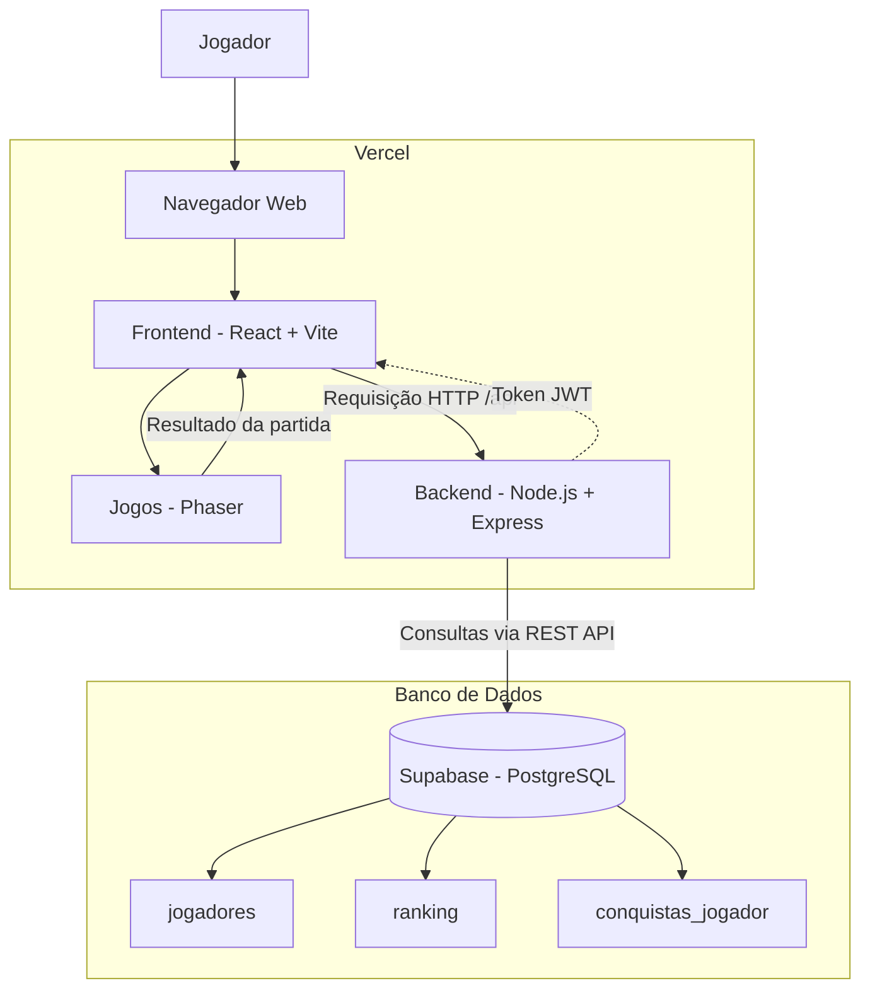

# JBIFC — Portal de Minijogos

A **JBIFC** é uma empresa fictícia de desenvolvimento de jogos, criada no contexto de um projeto acadêmico. Seu primeiro lançamento é **A Regular Mosquito's Day**, um jogo web de entretenimento no estilo arcade, inspirado em títulos como *WarioWare* e *Dumb Ways to Die*, com estética pixel art e desafios variados.

O jogo reúne diferentes minijogos que testam os reflexos, a atenção e a capacidade de reação dos jogadores. A plataforma conta com sistema de contas, pontuação, ranking online e conquistas.

> **Aviso:** Este é um projeto acadêmico independente, sem vínculo institucional com o Instituto Federal Catarinense (IFC).

---

## Sumário

- [Sobre o projeto](#sobre-o-projeto)
- [Objetivo e público-alvo](#objetivo-e-público-alvo)
- [Funcionalidades](#funcionalidades)
- [Responsividade](#responsividade)
- [Minijogos](#minijogos)
- [Tecnologias utilizadas](#tecnologias-utilizadas)
- [Arquitetura](#arquitetura)
- [Estrutura do projeto](#estrutura-do-projeto)
- [Banco de dados](#banco-de-dados)
- [Características e segurança](#características-e-segurança)
- [Executando localmente](#executando-localmente)
- [Variáveis de ambiente](#variáveis-de-ambiente)
- [API](#api)
- [Publicação](#publicação)
- [Equipe](#equipe)
- [Licenças e créditos](#licenças-e-créditos)

---

## Sobre o projeto

*A Regular Mosquito's Day* é um jogo web de entretenimento com temática arcade, composto por um portal que reúne uma coleção de minijogos independentes.

Cada partida é formada por uma sequência de desafios curtos. O jogador começa com três vidas e precisa cumprir as instruções apresentadas em cada rodada. Cada vitória concede pontos, enquanto cada derrota consome uma vida.

Ao perder todas as vidas, a partida termina. Jogadores autenticados podem salvar suas pontuações no banco de dados e acompanhar seu desempenho no ranking.

O projeto foi desenvolvido com foco em:

- Desenvolvimento de aplicações web modernas.
- Integração entre frontend, backend e banco de dados.
- Autenticação e segurança de usuários.
- Desenvolvimento de jogos 2D executados no navegador.
- Organização modular e manutenção de código.

## Objetivo e público-alvo

O objetivo do projeto é oferecer uma plataforma de entretenimento acessível pelo navegador, reunindo minijogos independentes em uma única aplicação, com desafios rápidos e diferentes mecânicas de interação.

O projeto também busca aplicar conhecimentos de desenvolvimento web, integração de sistemas, persistência de dados, autenticação e desenvolvimento de jogos.

**Problema abordado:** muitos jogos de navegador oferecem experiências isoladas, sem necessariamente reunir diferentes desafios, acompanhamento de desempenho e competição entre jogadores em uma única plataforma. A proposta é centralizar essas experiências em um portal com funcionalidades integradas.

**Público-alvo:** pessoas interessadas em jogos casuais, desafios rápidos e experiências no estilo arcade, especialmente usuários que acessam jogos por computadores e navegadores web.

---

## Funcionalidades

### Portal

- Página inicial com apresentação do projeto.
- Navegação entre as páginas.
- Página de tutorial e instruções.
- Página de apresentação da equipe.
- Interface com identidade visual própria.
- Layout responsivo para diferentes tamanhos de tela.

### Contas e autenticação

- Cadastro com nome de usuário e senha.
- Login com autenticação JWT.
- Senhas armazenadas por meio de hash bcrypt.
- Verificação da autenticação do usuário em rotas protegidas.
- Possibilidade de jogar sem conta no modo de demonstração.

### Sistema de jogo

- Partidas com três vidas.
- Seleção de minijogos.
- Instruções antes de cada rodada.
- Sistema de pontuação.
- Sequência de vitórias.
- Dificuldade progressiva.
- Tela de fim de partida.
- Opção de tentar novamente o salvamento de uma pontuação.

### Ranking e conquistas

- Ranking online integrado ao Supabase.
- Registro da melhor pontuação de cada jogador.
- Classificação por pontuação e critérios de desempate.
- Destaque para os três primeiros colocados.
- Sistema de conquistas.
- Registro do total de partidas dos jogadores.

---

## Responsividade

O portal **A Regular Mosquito's Day** possui uma interface responsiva, adaptada para diferentes tamanhos de tela, incluindo computadores, tablets e smartphones.

A responsividade contempla as páginas institucionais, os menus, os elementos de navegação e os demais componentes da interface web.

**Limitação:** embora o portal possa ser acessado em dispositivos móveis, os minijogos foram desenvolvidos e otimizados para computadores. Portanto, a experiência de jogo em smartphones e tablets não é garantida, podendo apresentar limitações de jogabilidade, controles ou visualização.

| Componente | Responsividade |
|---|---|
| Portal e páginas institucionais | Responsivo |
| Menus e navegação | Responsivos |
| Interface geral | Adaptável a diferentes telas |
| Minijogos Phaser | Otimizados para computadores |
| Jogabilidade em dispositivos móveis | Não garantida |

---

## Minijogos

O projeto possui atualmente os seguintes minijogos:

| Minijogo | Arquivo |
|---|---|
| Lockpick | `lockpick.js` |
| Não Seja Pego | `naoSejaPego.js` |
| Vigília dos Porcos | `vigiliaDosPorcos.js` |

Cada minijogo possui sua própria implementação, permitindo adicionar novos desafios sem precisar reescrever o funcionamento principal das partidas.

---

## Tecnologias utilizadas

### Frontend

| Tecnologia | Utilização |
|---|---|
| JavaScript | Linguagem de programação principal |
| React 19 | Construção da interface |
| Vite | Ambiente de desenvolvimento e build |
| Tailwind CSS 4 | Estilização |
| React Router | Navegação entre páginas |
| Phaser 4 | Desenvolvimento dos minijogos |
| Axios | Comunicação com a API |
| Lucide React | Ícones |

### Backend

| Tecnologia | Utilização |
|---|---|
| JavaScript (Node.js) | Linguagem e ambiente de execução |
| Express 5 | Construção da API |
| Supabase | Acesso ao banco PostgreSQL por API REST |
| bcryptjs | Geração e verificação de hashes de senhas |
| JSON Web Token | Autenticação de usuários |
| express-rate-limit | Limitação de requisições |
| CORS | Controle de acesso entre origens |
| dotenv | Gerenciamento de variáveis de ambiente |

### Infraestrutura e ferramentas

- **Vercel Services:** hospedagem do frontend e backend.
- **Supabase:** gerenciamento do banco de dados PostgreSQL.
- **Git e GitHub:** versionamento e gerenciamento do código.
- **Visual Studio Code:** ambiente de desenvolvimento.

---

## Arquitetura

O projeto utiliza uma arquitetura cliente-servidor, dividida em frontend, backend e banco de dados.

### Diagrama de arquitetura



### Funcionamento da arquitetura

O **frontend** é responsável pela interface, navegação e execução dos jogos. O Phaser executa os minijogos e comunica os resultados das partidas ao React, que realiza o envio das pontuações ao backend por meio de requisições HTTP.

O **backend** processa as requisições, valida os dados recebidos, autentica os usuários e realiza as operações necessárias no banco de dados.

O **banco de dados** mantém as informações dos jogadores, pontuações e conquistas, utilizando PostgreSQL por meio do Supabase.

### Organização dos serviços na Vercel

O projeto utiliza dois serviços dentro da mesma estrutura de implantação:

- `frontend`: aplicação React construída com Vite.
- `backend`: API desenvolvida com Express.

As requisições iniciadas com `/api/` são direcionadas ao backend. As demais são encaminhadas ao frontend.

---

## Estrutura do projeto

```text
JBIFC/
├── backend/
│   ├── conquistas.js
│   ├── server.js
│   ├── supabase-schema.sql
│   └── package.json
│
├── docs/
│   ├── Requisitos.md
│   └── structure.txt
│
├── frontend/
│   ├── public/
│   │   ├── fonts/
│   │   ├── game/
│   │   └── music/
│   │
│   ├── src/
│   │   ├── assets/
│   │   ├── components/
│   │   ├── config/
│   │   ├── game/
│   │   │   ├── cenas/
│   │   │   └── minigames/
│   │   ├── pages/
│   │   └── styles/
│   │
│   ├── index.html
│   ├── vite.config.js
│   └── package.json
│
├── .gitignore
├── vercel.json
└── README.md
```

### Organização do frontend

- `components/`: componentes reutilizáveis da interface.
- `config/`: configurações e funcionalidades auxiliares, incluindo conquistas.
- `game/cenas/`: cenas responsáveis pelo fluxo do jogo.
- `game/minigames/`: implementações individuais dos minijogos.
- `pages/`: páginas principais do portal.
- `styles/`: estilos globais, fontes e identidade visual.

### Organização do backend

- `server.js`: configuração do servidor, rotas, autenticação e operações com o banco.
- `conquistas.js`: regras e processamento das conquistas.
- `supabase-schema.sql`: estrutura SQL do banco de dados.

---

## Banco de dados

O projeto utiliza PostgreSQL por meio do Supabase.

O banco possui três tabelas principais:

| Tabela | Responsabilidade |
|---|---|
| `jogadores` | Armazena contas, hashes de senha e total de partidas. |
| `ranking` | Armazena a melhor pontuação registrada de cada jogador. |
| `conquistas_jogador` | Armazena as conquistas desbloqueadas pelos jogadores. |

Também existe a view `ranking_posicoes`, responsável por calcular a posição dos jogadores com base na pontuação e nos critérios de desempate.

### Relacionamentos

- Um jogador pode possuir um registro no ranking.
- Um jogador pode desbloquear várias conquistas.
- A exclusão de um jogador remove seus registros relacionados por meio de exclusão em cascata.

A estrutura completa do banco pode ser encontrada em:

`backend/supabase-schema.sql`

---

## Características e segurança

### Usabilidade e responsividade

O portal possui layout responsivo, adaptando sua interface a diferentes resoluções de tela, incluindo computadores, tablets e celulares.

Entretanto, existe uma distinção importante: **a interface do portal é responsiva, mas os minijogos foram desenvolvidos para utilização em computadores**. Portanto, a experiência de jogo em dispositivos móveis não é suportada, especialmente devido às limitações de interação por toque e à adaptação dos controles.

A navegação entre as páginas e a organização dos conteúdos buscam facilitar o acesso às funcionalidades disponíveis.

### Desempenho

- O Vite é utilizado para o desenvolvimento e a geração da versão de produção do frontend.
- Os minijogos são carregados e executados no navegador por meio do Phaser.
- A comunicação entre frontend e backend utiliza requisições HTTP.
- O banco de dados centraliza as informações persistentes dos jogadores.
- O código dos minijogos é organizado em módulos independentes, facilitando sua manutenção e expansão.

### Acessibilidade

A interface utiliza textos, elementos visuais e componentes de navegação para orientar o usuário durante a utilização do portal.

Os minijogos, entretanto, possuem interações específicas e não foram projetados para garantir compatibilidade completa com tecnologias assistivas. O projeto não declara conformidade com padrões como WCAG.

### Segurança

A aplicação utiliza diferentes mecanismos para proteger as contas dos jogadores e restringir o acesso aos dados.

**1. Proteção de senhas com bcrypt**

As senhas não são armazenadas diretamente no banco de dados. Durante o cadastro, o backend utiliza `bcryptjs` para gerar um hash da senha. No login, a senha informada é comparada com o hash armazenado.

Isso reduz o impacto de uma eventual exposição dos registros, pois as senhas originais não ficam disponíveis em texto puro.

**2. Autenticação com JWT**

Após o login, o backend gera um JSON Web Token (JWT), utilizado para identificar o jogador nas requisições que exigem autenticação.

As rotas protegidas verificam a validade do token antes de permitir determinadas operações, como o registro de pontuações. O segredo utilizado para assinar os tokens é armazenado em uma variável de ambiente (`JWT_SECRET`), não diretamente no código-fonte.

**3. Proteção das credenciais do Supabase**

O backend utiliza a chave de serviço (`SUPABASE_SERVICE_ROLE_KEY`) para realizar operações no banco de dados.

Essa chave possui permissões elevadas e deve permanecer exclusivamente no ambiente do servidor. Ela não deve ser incluída no código do frontend, em variáveis públicas com prefixo `VITE_` ou em arquivos enviados ao GitHub.

**4. Row Level Security (RLS)**

As tabelas do Supabase possuem Row Level Security habilitado. As permissões de acesso direto para os papéis públicos `anon` e `authenticated` são revogadas na configuração atual.

Com isso, as operações de banco são centralizadas no backend, que utiliza a chave de serviço para acessar os dados.

**5. Limitação de requisições**

O backend utiliza `express-rate-limit` para limitar a quantidade de requisições em determinados intervalos. Esse mecanismo ajuda a reduzir abusos, tentativas automatizadas de acesso e sobrecarga causada por requisições excessivas.

**6. Controle de acesso entre origens**

O backend utiliza CORS para controlar as origens que podem realizar requisições à API, conforme a configuração do servidor.

**7. Variáveis de ambiente**

Informações sensíveis, como chaves de acesso e segredos de autenticação, são armazenadas em variáveis de ambiente. O arquivo `.env` deve permanecer fora do controle de versão.

> **Observação:** essas medidas reduzem riscos, mas não representam uma garantia de segurança absoluta. A autenticação também não substitui mecanismos específicos de validação contra manipulação de resultados enviados pelo cliente. A proteção contra fraudes de pontuação depende de validações adicionais no servidor.

---

## Executando localmente

### Pré-requisitos

Antes de iniciar, instale:

- [Node.js](https://nodejs.org/).
- npm.
- Git.
- Uma conta no [Supabase](https://supabase.com/).

### 1. Clonar o repositório

```bash
git clone https://github.com/EduardoSchultz505/JBIFC.git
cd JBIFC
```

### 2. Configurar o banco de dados

Crie um projeto no Supabase e execute o conteúdo do arquivo:

`backend/supabase-schema.sql`

Isso criará as tabelas, índices, relacionamentos e configurações necessárias para o funcionamento do banco.

### 3. Instalar as dependências do backend

```bash
cd backend
npm install
```

Crie um arquivo `.env` dentro da pasta `backend/` com as variáveis necessárias.

### 4. Instalar as dependências do frontend

Em outro terminal, a partir da raiz do projeto:

```bash
cd frontend
npm install
```

### 5. Iniciar o backend

Dentro da pasta `backend/`:

```bash
npm run dev
```

O servidor será iniciado localmente na porta 5000.

### 6. Iniciar o frontend

Dentro da pasta `frontend/`:

```bash
npm run dev
```

O Vite disponibilizará o frontend, normalmente em:

[http://localhost:5173](http://localhost:5173)

---

## Variáveis de ambiente

As variáveis de ambiente devem ser configuradas localmente e também no painel da Vercel.

### Backend

Crie o arquivo `backend/.env`:

```env
SUPABASE_URL=sua_url_supabase
SUPABASE_SERVICE_ROLE_KEY=sua_chave_de_servico
JWT_SECRET=seu_segredo_jwt
```

As chaves devem ser obtidas nas configurações do projeto Supabase.

- `SUPABASE_URL`: endereço do projeto Supabase.
- `SUPABASE_SERVICE_ROLE_KEY`: chave privada utilizada pelo backend para acessar o banco.
- `JWT_SECRET`: segredo utilizado para assinar e verificar os tokens de autenticação.


### Frontend

Não é necessária uma variável `VITE_API_URL` na configuração atual. As requisições utilizam caminhos relativos, como `/api/login` e `/api/ranking`.

---

## API

A API utiliza JSON para comunicação entre frontend e backend.

As principais rotas são:

| Método | Rota | Descrição | Autenticação |
|---|---|---|---|
| POST | `/api/conta` | Cadastro de jogador | Não |
| POST | `/api/login` | Login | Não |
| GET | `/api/usuario` | Consulta o usuário autenticado | Sim |
| GET | `/api/usuarios/:usuario` | Consulta informações de um jogador | Conforme implementação |
| GET | `/api/conquistas` | Consulta conquistas | Sim |
| GET | `/api/ranking` | Consulta o ranking | Não |
| POST | `/api/ranking` | Registra ou atualiza a pontuação | Sim |
| GET | `/api/health` | Verifica o estado da API | Não |

As rotas protegidas utilizam JWT enviado no cabeçalho HTTP:

```http
Authorization: Bearer SEU_TOKEN
```

As respostas da API são fornecidas em JSON.

---

## Publicação

O JBIFC está configurado para publicação utilizando Vercel Services.

A estrutura de implantação é definida pelo arquivo `vercel.json`, localizado na raiz do repositório.

### Serviços

| Serviço | Diretório | Tecnologia |
|---|---|---|
| Frontend | `frontend/` | Vite |
| Backend | `backend/` | Express |

### Fluxo de publicação

1. O código é versionado no GitHub.
2. O repositório é conectado à Vercel.
3. A Vercel identifica os serviços definidos no `vercel.json`.
4. As variáveis de ambiente são cadastradas nas configurações do projeto.
5. A plataforma realiza o build e publica os serviços.

O frontend e o backend utilizam o mesmo domínio público, com as requisições `/api/*` encaminhadas ao serviço backend.

---

## Equipe

| Integrante | Participação no desenvolvimento |
|---|---|
| Eduardo Schultz | Desenvolvimento do frontend e dos minijogos. |
| Endrio Ruan | Design dos minijogos. |
| Guilherme Otávio | Design dos minijogos. |
| Gustavo Kell | Design dos minijogos. |
| João Araldi | Organização de equipe e Testes. |
| Vinicius Pecini | Desenvolvimento do backend e da API. |

---

## Licenças e créditos

Os arquivos gráficos e elementos visuais próprios do projeto foram desenvolvidos pela equipe da JBIFC.

As músicas e fontes utilizadas foram obtidas de fontes externas. Seus respectivos créditos e condições de uso devem ser consultados nas páginas de distribuição originais.

O projeto possui finalidade acadêmica e de demonstração, não representando oficialmente o Instituto Federal Catarinense.